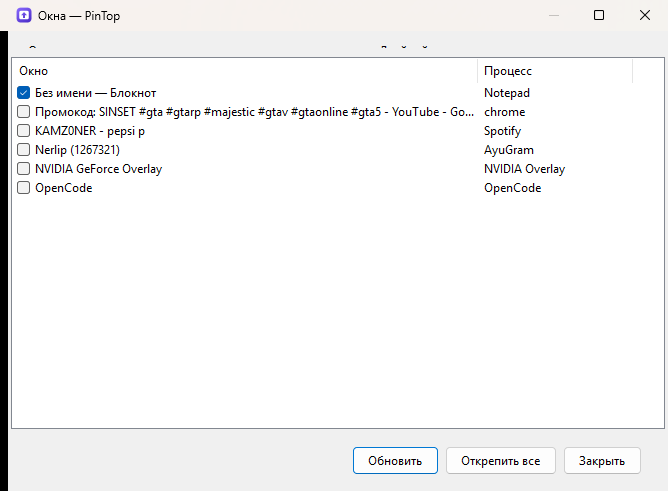
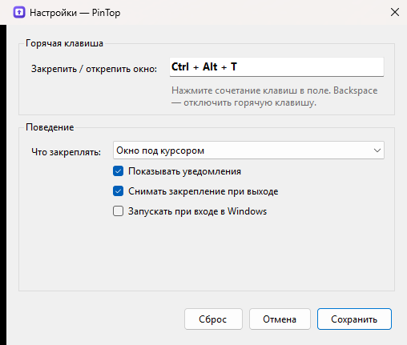

<p align="center">
  
</p>

<h1 align="center">PinTop</h1>

<p align="center"><em>Keep any window always on top with a single hotkey.</em></p>

<p align="center">
  <a href="../../releases/latest"></a>
  
  
  
</p>

<p align="center"><a href="README.ru.md">Русский</a> · English</p>

---

PinTop is a tiny tray app for Windows. Point at a window, press **Ctrl + Alt + T** — it stays above
everything else until you press the hotkey again. No installation, no account, no telemetry: a single
`.exe` that sits in the notification area.

## Features

- **Global hotkey** — pin/unpin the window under the cursor (`Ctrl + Alt + T` by default, fully rebindable).
- **Tray menu** — pin the last active window without remembering shortcuts; double-click the tray icon to toggle.
- **Window list** — see every open window and tick the ones that should stay on top.
- **Ownership-safe** — PinTop only touches windows you choose, and can restore them on exit.
- **Notifications** — a short toast tells you what was pinned or unpinned (can be turned off).
- **Start with Windows** — one checkbox, stored in your user profile.
- **Bilingual UI** — Russian or English, following the Windows display language.
- **Portable** — one self-contained executable, no .NET install required.

## Screenshots

| Window list | Settings |
| --- | --- |
|  |  |

## Install

1. Open [Releases](../../releases/latest) and download `PinTop-win-x64.zip`.
2. Unpack it anywhere and run `PinTop.exe`.
3. If Windows SmartScreen shows a warning (the build is unsigned), choose **More info → Run anyway**.

Requirements: Windows 10 or 11, x64. The release build is self-contained, so no .NET runtime is needed.

> Prefer to build it yourself? See [Build from source](#build-from-source).

## Usage

| What | How |
| --- | --- |
| Pin / unpin the window under the cursor | `Ctrl + Alt + T` |
| Pin / unpin the last active window | Tray icon → *Pin window* (double-click the icon) |
| Choose windows from a list | Tray icon → *Window list* |
| Change hotkey, target, autostart | Tray icon → *Settings* |
| Quit | Tray icon → *Exit* |

By default the hotkey uses the window **under the cursor**. If you prefer the **active window**, switch
it in Settings. The same shortcut appears next to the tray menu item, so it is easy to look up.

Pinned windows are tracked for the current session. With *Unpin windows on exit* enabled (default),
closing PinTop returns every window it pinned to its normal state.

## Settings

Settings live in `%APPDATA%\PinTop\settings.json` and are created on first run:

```json
{
  "hotkeyModifiers": 3,
  "hotkeyKey": "T",
  "showNotifications": true,
  "target": "WindowUnderCursor",
  "runAtStartup": false,
  "restoreOnExit": true
}
```

Delete the file to reset everything. `hotkeyModifiers` is a bit mask: `1` = Alt, `2` = Ctrl,
`4` = Shift, `8` = Win.

## How it works

PinTop is intentionally small; all of the magic is in about 250 lines of Win32 interop:

- `SetWindowPos(hwnd, HWND_TOPMOST / HWND_NOTOPMOST, …)` toggles the `WS_EX_TOPMOST` style of the
  target window, read back with `GetWindowLongPtr(GWL_EXSTYLE)`.
- `WindowFromPoint` + `GetAncestor(GA_ROOT)` turns the cursor position into a top-level window.
- `RegisterHotKey` on a message-only window provides the global hotkey without keyboard hooks.
- A `NotifyIcon` and two WinForms dialogs provide the tray and the management UI.

No DLL injection, no keyboard hooks, no background services.

## Limitations

- Windows running elevated (as administrator) cannot be pinned unless PinTop itself runs elevated,
  because of Windows UIPI restrictions. PinTop deliberately requests no privileges.
- Exclusive-fullscreen games are not affected — they own the whole screen anyway.
- Windows Store / UWP apps are pinned at their app frame, which is what you want in practice.
- The window must be top-level and visible; windows without a frame (some overlays) may ignore the request.

## Build from source

Requirements: Windows 10/11 and the [.NET 10 SDK](https://dotnet.microsoft.com/download).

```powershell
dotnet build PinTop.sln -c Release

# portable, self-contained single file
dotnet publish src/PinTop/PinTop.csproj -c Release -r win-x64 --self-contained true `
  -p:PublishSingleFile=true -p:EnableCompressionInSingleFile=true -o dist
```

`dist\PinTop.exe` is ready to share.

### Repository layout

```
src/PinTop/            application (WinForms + Win32 interop)
  Interop/             P/Invoke declarations
  Services/            window pinning, hotkey, settings, strings
  UI/                  window list and settings dialogs
tools/make-icon.ps1            regenerates src/PinTop/Resources/app.ico and docs/icon.png
tools/capture-screenshots.ps1  regenerates docs/screenshot-*.png (Debug build + desktop)
tools/smoke-test.ps1           end-to-end hotkey check against a Notepad window
```

The screenshot helper uses a `PINTOP_UI_PREVIEW` environment variable that only exists in Debug builds
(`#if DEBUG`), so release binaries never contain it.

## Contributing

Bug reports and pull requests are welcome — see [CONTRIBUTING.md](CONTRIBUTING.md). Please keep changes
small and in the spirit of the project: no telemetry, no network access, no installers.

## License

[MIT](LICENSE)
