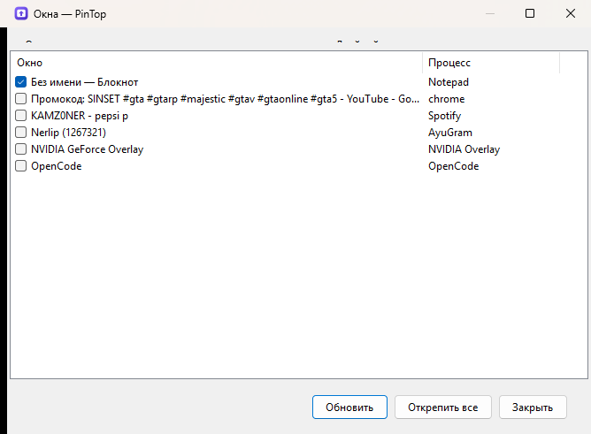
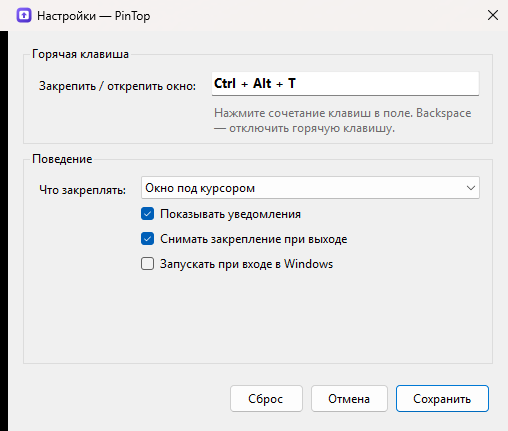

<p align="center">
  
</p>

<h1 align="center">PinTop</h1>

<p align="center"><em>Закрепляйте любое окно поверх остальных одним нажатием горячей клавиши.</em></p>

<p align="center">
  <a href="../../releases/latest"></a>
  
  
  
</p>

<p align="center">Русский · <a href="README.md">English</a></p>

---

PinTop — небольшое приложение в области уведомлений Windows. Наведите курсор на окно и нажмите
**Ctrl + Alt + T** — оно останется поверх остальных, пока вы не нажмёте клавиши снова. Без установки,
аккаунтов и телеметрии: один `.exe`, который живёт в трее.

## Возможности

- **Глобальная горячая клавиша** — закрепляет окно под курсором (`Ctrl + Alt + T` по умолчанию, можно изменить).
- **Меню в трее** — закрепить последнее активное окно, не вспоминая сочетания; двойной щелчок по иконке тоже переключает закрепление.
- **Список окон** — все открытые окна с флажками: отметьте те, что должны быть сверху.
- **Аккуратно с окнами** — PinTop трогает только выбранные окна и может вернуть их в обычное состояние при выходе.
- **Уведомления** — короткое всплывающее сообщение о том, что закреплено или откреплено (можно отключить).
- **Автозапуск** — один флажок в настройках, хранится в профиле пользователя.
- **Два языка интерфейса** — русский или английский, в зависимости от языка Windows.
- **Портативность** — один самодостаточный exe, .NET устанавливать не нужно.

## Скриншоты

| Список окон | Настройки |
| --- | --- |
|  |  |

## Установка

1. Откройте [Releases](../../releases/latest) и скачайте `PinTop-win-x64.zip`.
2. Распакуйте в любую папку и запустите `PinTop.exe`.
3. Если SmartScreen покажет предупреждение (сборка без цифровой подписи), нажмите **Подробнее → Выполнить всё равно**.

Требования: Windows 10 или 11, x64. Release-сборка самодостаточная — .NET устанавливать не нужно.

> Хотите собрать самостоятельно? См. [Сборка из исходников](#сборка-из-исходников).

## Как пользоваться

| Действие | Как |
| --- | --- |
| Закрепить / открепить окно под курсором | `Ctrl + Alt + T` |
| Закрепить / открепить последнее активное окно | Иконка в трее → *Закрепить окно* (или двойной щелчок) |
| Выбрать окна из списка | Иконка в трее → *Список окон* |
| Сменить клавишу, цель, автозапуск | Иконка в трее → *Настройки* |
| Выход | Иконка в трее → *Выход* |

По умолчанию горячая клавиша берёт окно **под курсором**. Если удобнее закреплять **активное окно**,
переключите это в настройках. Текущее сочетание показывается рядом с пунктом меню.

Закреплённые окна запоминаются на время сеанса. Если включена опция «Снимать закрепление при выходе»
(по умолчанию), при закрытии PinTop все его окна возвращаются в обычный режим.

## Настройки

Файл `%APPDATA%\PinTop\settings.json` создаётся при первом запуске:

```json
{
  "hotkeyModifiers": 3,
  "hotkeyKey": "T",
  "showNotifications": true,
  "target": "WindowUnderCursor",
  "runAtStartup": false,
  "restoreOnExit": true
}
```

Удалите файл, чтобы сбросить настройки. `hotkeyModifiers` — битовая маска: `1` = Alt, `2` = Ctrl,
`4` = Shift, `8` = Win.

## Как это устроено

Вся логика — примерно 250 строк Win32-интеропа:

- `SetWindowPos(hwnd, HWND_TOPMOST / HWND_NOTOPMOST, …)` переключает стиль `WS_EX_TOPMOST`, который
  читается через `GetWindowLongPtr(GWL_EXSTYLE)`.
- `WindowFromPoint` + `GetAncestor(GA_ROOT)` превращают позицию курсора в окно верхнего уровня.
- `RegisterHotKey` на message-only окне даёт глобальную горячую клавишу без клавиатурных хуков.
- `NotifyIcon` и два диалога WinForms — трей и управление окнами.

Никакой инъекции DLL, хуков и фоновых служб.

## Ограничения

- Окна, запущенные от администратора, нельзя закрепить, если сам PinTop не запущен с повышенными
  правами (ограничение UIPI). PinTop специально не просит прав.
- Полноэкранные игры в эксклюзивном режиме не затрагиваются — они и так занимают весь экран.
- Приложения из Microsoft Store (UWP) закрепляются на уровне их оконного фрейма — на практике это то, что нужно.
- Окно должно быть верхнего уровня и видимым: некоторые оверлеи без рамки могут игнорировать запрос.

## Сборка из исходников

Нужны Windows 10/11 и [.NET 10 SDK](https://dotnet.microsoft.com/download).

```powershell
dotnet build PinTop.sln -c Release

# портативный самодостаточный exe
dotnet publish src/PinTop/PinTop.csproj -c Release -r win-x64 --self-contained true `
  -p:PublishSingleFile=true -p:EnableCompressionInSingleFile=true -o dist
```

Готовый файл — `dist\PinTop.exe`.

### Структура репозитория

```
src/PinTop/            приложение (WinForms + Win32 interop)
  Interop/             объявления P/Invoke
  Services/            закрепление окон, хоткей, настройки, строки
  UI/                  список окон и настройки
tools/make-icon.ps1            пересобирает src/PinTop/Resources/app.ico и docs/icon.png
tools/capture-screenshots.ps1  пересобирает docs/screenshot-*.png (Debug-сборка + рабочий стол)
tools/smoke-test.ps1           сквозная проверка хоткея на окне Блокнота
```

Скрипт скриншотов использует переменную окружения `PINTOP_UI_PREVIEW`, которая есть только в Debug-сборке
(`#if DEBUG`), поэтому в релизные бинарники она не попадает.

## Участие

Сообщения об ошибках и pull request'ы приветствуются — см. [CONTRIBUTING.md](CONTRIBUTING.md).
Держите изменения небольшими и в духе проекта: без телеметрии, сетевых запросов и установщиков.

## Лицензия

[MIT](LICENSE)
